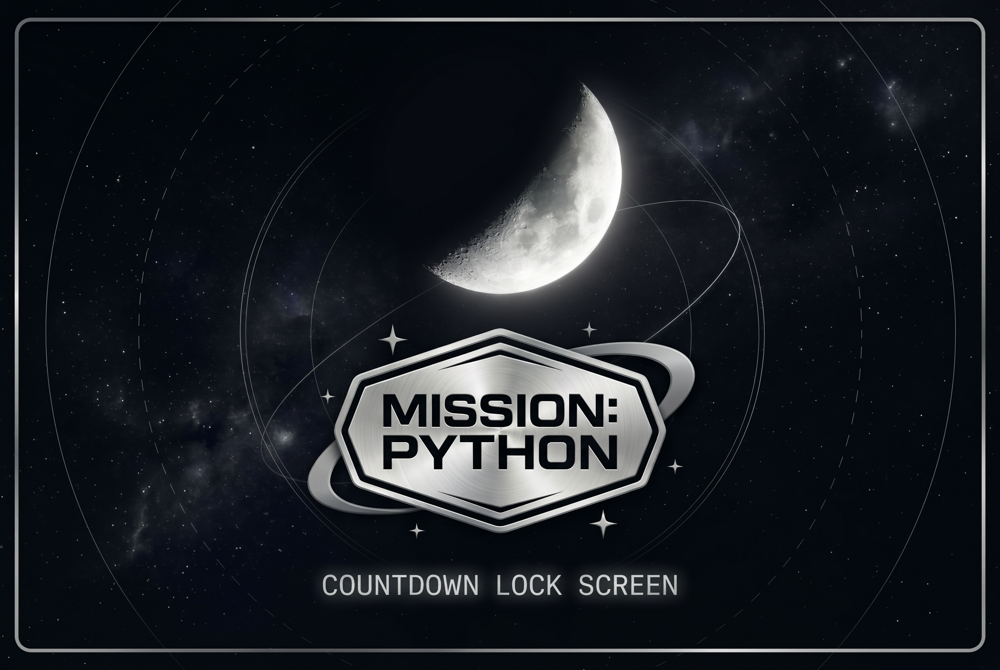
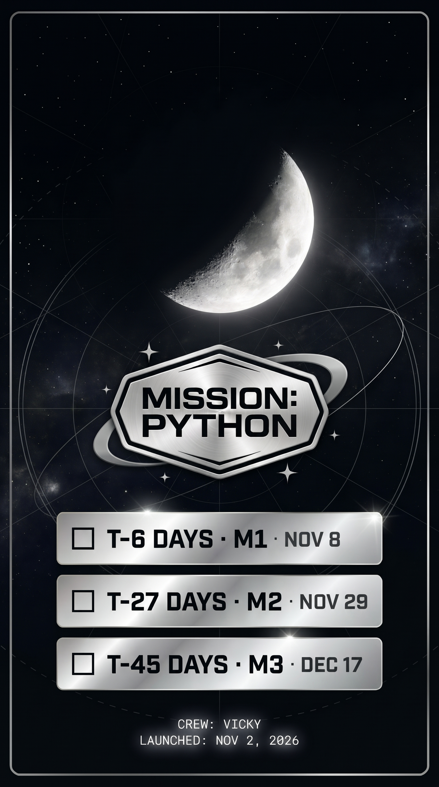

# 🌖 MISSION: PYTHON
## 🎯 Objective  
MISSION: PYTHON is a NASA-inspired countdown lock screen built with Gemini, tracking three Python project milestones against a silvery moon and deep space backdrop. Refined through iterative prompt engineering for clean mobile readability on iPhone. Claude was used for prompt strategy and design direction throughout the process.
## 🛠️ Tools  
Gemini, Claude 

## 🤵🏻 Lock Screen and Cover Prompts  

<strong>View Lock Screen Prompt #1</strong>

Generate a high-resolution vertical phone lock screen wallpaper for iPhone 11 (9:19.5 ratio), titled “MISSION: PYTHON”.
Layout (top to bottom):
- Top 30%: empty, only stars and faint background, so the iPhone clock fits.
- Large glowing crescent moon as the hero visual.
- Below the moon: a NASA-style hexagon mission patch in embossed silver reading “MISSION: PYTHON”, with clear space between it and the cards.
- Three slim, short metallic silver foil cards, evenly spaced, each with an empty checkbox on the left:
  - ☐ T-6 DAYS · M1 · NOV 8
  - ☐ T-27 DAYS · M2 · NOV 29
  - ☐ T-45 DAYS · M3 · DEC 17
- Bottom area, kept clear of the corners: “CREW: VICKY” and “LAUNCHED: NOV 2, 2026” in small monospace.
Style:
- Deep space black background with scattered stars.
- Subtle silver star map coordinate lines, with very few labels, none behind the patch, and no garbled text.
- Thin metallic silver border frame like a mission briefing document.
- Cards: smooth, glossy, mirror-like chrome with bright light reflections, like polished spacecraft panels, with minimal scratches.
- Card text: dark, in bold monospace or condensed type. Milestone label bold, date lighter, smaller size.
- Color palette: black, bright silver, white, chrome.
- Keep it clean, with breathing room between all elements.

<strong>View Lock Screen Prompt #2</strong>

Keep the same design. Make it taller, 9:19.5 for iPhone 11. Move the moon down slightly so the top 25% stays empty. Make the silver star map coordinate lines more visible in the background. Add a thin orbit ring and small stars around the MISSION: PYTHON badge like a NASA patch. Make “CREW: VICKY” and “LAUNCHED” text brighter silver.

<strong>View Lock Screen Prompt #3</strong>

Keep the same design. Make the orbit ring pass behind the “MISSION: PYTHON” text so the text is fully readable. Make “CREW: VICKY” and “LAUNCHED” text the same bright silver. Make the image taller for iPhone 11 (9:19.5).

<strong>View Lock Screen Prompt #4</strong>

Keep everything the same. Make the date text on the cards slightly darker for better contrast.

<strong>View Cover Prompt #1</strong>

Make a 3:2 landscape cover, at least 1200px wide, with the same moon, star map, and silver foil style. Center the silver “MISSION: PYTHON” badge with the orbit ring and sparkles. Add “COUNTDOWN LOCK SCREEN” in small silver monospace underneath. No other text.

<strong>View Final Prompt</strong>

Keep everything the same. Remove the horizontal and vertical grid lines from the background. Keep only the circular star map coordinate lines and the background orbit circle. Keep the orbit ring on the MISSION: PYTHON badge. High resolution JPG for both images.

## 📱 Lock Screen and Cover Images  

